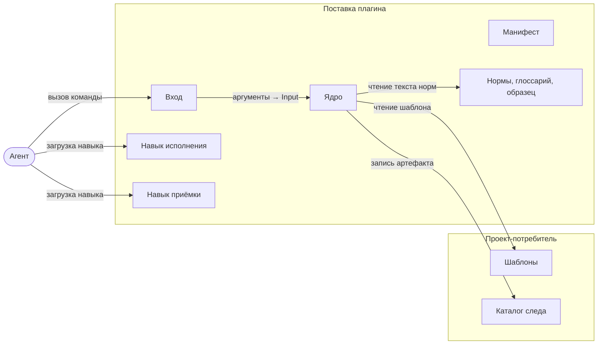
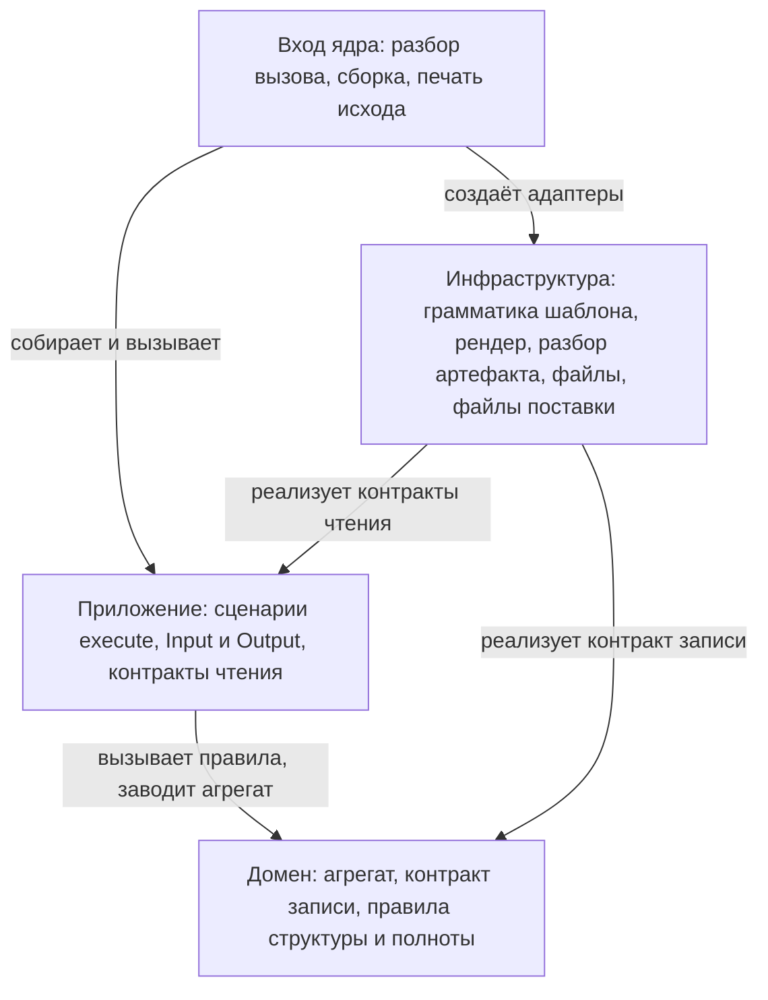
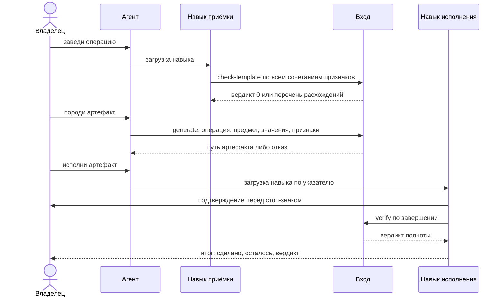

# Архитектура образца

Компоненты плагина по образцу APB, направление зависимостей между слоями ядра, поток
порождённого артефакта и раскладка файлов. Понятия определены в [index.md](./index.md#понятия-образца).

---

## Навигация

- [Компоненты плагина](#компоненты-плагина)
- [Раскладка поставки](#раскладка-поставки)
- [Слои ядра](#слои-ядра)
- [Контракты ядра](#контракты-ядра)
- [Поток артефакта](#поток-артефакта)
- [Разделение ролей](#разделение-ролей)
- [Коды возврата](#коды-возврата)
- [Состояние и его места](#состояние-и-его-места)
- [Версионирование](#версионирование)

---

## Компоненты плагина

Плагин состоит из шести компонентов поставки и опирается на три принадлежности
проекта-потребителя.



| Компонент | Ответственность |
|-----------|-----------------|
| Манифест | Имя, версия и описание плагина; версия меняется осознанной правкой |
| Вход | Разбор вызова, сборка ядра, печать исхода, код возврата |
| Ядро | Порождение, приёмка шаблона, структурная проверка, проверка полноты исполнения, выдача норм |
| Навык исполнения | Порядок исполнения порождённого артефакта: признаки, отметки, стоп-знаки, итоговая проверка |
| Навык приёмки | Путь от вопроса «нужен ли артефакт» до шаблона, принятого прогоном |
| Нормы, глоссарий, образец | Данные поставки: правила предмета с кодами, определения понятий, образцовый шаблон |
| Шаблоны | Состав артефакта каждой предметной операции; принадлежат проекту |
| Каталог следа | Порождённые артефакты; принадлежат проекту |

---

## Раскладка поставки

Всё, что входит в поставку, лежит под корнем плагина: файл вне корня платформа потребителю
не доставляет.

```text
<корень репозитория-источника>/
├── .claude-plugin/
│   └── marketplace.json         запись маркетплейса: источник — относительный путь к плагину
├── .claude/
│   └── settings.json            локальный маркетплейс репозитория-источника и включение плагина
├── plugin/<плагин>/             корень плагина — единица поставки
│   ├── .claude-plugin/
│   │   └── plugin.json          манифест: имя, версия
│   ├── bin/
│   │   └── <вход>               вход: POSIX sh, на PATH инструмента Bash
│   ├── lib/
│   │   └── python-env.sh        ленивая сборка окружения интерпретатора
│   ├── src/
│   │   ├── requirements.txt     зависимости ядра: пусто либо пины точных версий
│   │   └── <пакет>/
│   │       ├── __main__.py      вход ядра: разбор вызова и точка сборки
│   │       ├── domain.py        домен
│   │       ├── application/     слой приложения: файл на сценарий и contracts.py
│   │       └── infrastructure.py
│   ├── skills/
│   │   ├── <навык исполнения>/SKILL.md
│   │   └── <навык приёмки>/SKILL.md
│   ├── templates/
│   │   └── sample-operation.md  образцовый шаблон — не рабочий
│   └── share/
│       ├── rules/<нормы>.md     нормы предмета с кодами
│       └── docs/glossary.md     глоссарий понятий норм
├── templates/                   шаблоны операций самого репозитория-источника
└── tests/                       проверки ядра и входа — в поставку не входят
```

Раскладка ядра внутри `src/<пакет>/` — воплощение эталона на Python. Требование образца —
разделение на слои и направление зависимостей, а не имена файлов: см.
[APB-004](./decisions.md#apb-004-слои-ядра).

---

## Слои ядра

Ядро разделено на три слоя по [CLAR-001](../../../rules/clean-architecture.md#слои-и-направление-зависимостей-clar-001);
вход ядра — внешний обработчик и точка сборки.



| Слой | Знает | Не знает |
|------|-------|----------|
| Домен | Чем артефакт обязан быть: адрес, версия шаблона, задачи с проверкой и признаком исполнения, каркас, таблица версий | Формата файла, грамматики шаблона, файловой системы, вызова |
| Приложение | Порядок шагов сценария, контракты чтения, исходы сценария | Разметки, путей, аргументов командной строки |
| Инфраструктура | Маркер версии, грамматику подстановок и блоков, разбор Markdown, путь артефакта, файлы поставки | Порядка шагов сценария, вызова |
| Вход ядра | Аргументы, умолчания каталогов, выводимые значения, тексты сообщений, коды возврата | Правил структуры — их применяет домен через сценарий |

Правила «чем артефакт обязан быть» живут в домене в одном экземпляре и вызываются
четырьмя сценариями: порождением до записи, приёмкой шаблона, структурной и полной проверками.
Это главная причина слоёв в инструменте такого размера: без домена правило имело бы
четыре носителя.

---

## Контракты ядра

Разделение контрактов следует [CQRS](../../../rules/cqrs.md#принцип): запись объявлена
в домене, чтение — в слое приложения.

| Контракт | Слой | Операции | Реализация в инфраструктуре |
|----------|------|----------|-----------------------------|
| Контракт записи артефактов | домен | `add(artifact, text) → written \| exists` | Каталог артефактов |
| Источник шаблона | приложение | `read(operation) → (version, text)` | Каталог шаблонов |
| Наличие артефакта | приложение | `exists(operation, subject)`, `path_of(operation, subject)` | Каталог артефактов |
| Источник артефакта | приложение | `read(path) → text` | Файл артефакта |
| Разбор артефакта | приложение | `parse(text) → документ домена` | Разбор Markdown |

Сценарии и их зависимости:

| Сценарий | Вид | Зависит от |
|----------|-----|------------|
| Порождение | команда | источник шаблона, наличие и запись артефакта, рендер, разбор |
| Приёмка шаблона | запрос | рендер, разбор |
| Структурная проверка | запрос | источник артефакта, разбор |
| Проверка полноты исполнения | запрос | источник артефакта, разбор |

```text
// ДОМЕН — контракт записи: только заведение, перезаписи нет [CQRS-001, CQRS-002]
Contract ArtifactRepository:
    add(artifact: Artifact, text: string): Outcome     // written | exists

// ДОМЕН — правила над разобранной структурой, без знания разметки [CLAR-002]
Function structureFindings(document: ArtifactDocument): list of Finding
Function executionFindings(document: ArtifactDocument): list of Finding

// ПРИЛОЖЕНИЕ — сценарий-команда: одна публичная операция [CLAR-008]
UseCase GenerateArtifactUseCase:
    constructor(templates: TemplateSource, artifacts: ArtifactLookup + ArtifactRepository,
                render: Render, parser: DocumentParser)
    execute(input: GenerateArtifactInput): GenerateArtifactOutput
        if artifacts.exists(input.operation, input.subject): return ALREADY_GENERATED
        (version, text) = templates.read(input.operation)
        rendered = render(text, input.values + {template_version: version}, input.flags)
        findings = structureFindings(parser.parse(rendered))     // проверка до записи
        if findings not empty: return REJECTED(findings)
        return artifacts.add(Artifact(input.operation, input.subject, version, values), rendered)
```

---

## Поток артефакта



| Шаг | Кто | Результат | Решение |
|-----|-----|-----------|---------|
| Приёмка шаблона | навык приёмки, вход | шаблон принят кодом `0` | [APB-010](./decisions.md#apb-010-приёмка-шаблона-перебором) |
| Порождение | вход | один файл артефакта либо отказ без файла | [APB-009](./decisions.md#apb-009-конвейер-артефакта) |
| Исполнение | навык исполнения | отметки задач и дописанные значения | [APB-008](./decisions.md#apb-008-навыки-и-разделение-ролей) |
| Проверка | вход | вердикт без правки файла | [APB-012](./decisions.md#apb-012-проверка-прогоном) |

---

## Разделение ролей

| Работа | Исполнитель | Почему так |
|--------|-------------|------------|
| Порождение, приёмка, проверки, выдача норм | вход | Детерминированная работа: один и тот же ввод даёт один и тот же результат, проверяется тестами |
| Порядок исполнения, сверка признаков, отметки | навык исполнения | Требует суждения агента о состоянии и диалога с владельцем |
| Подтверждение необратимого | владелец | Значения необратимой задачи рождаются по ходу исполнения и заранее не подтверждаются |
| Написание шаблона | вызывающий: агент или внешний инструмент | Навык принимает результат прогоном, способ составления не предписывает |
| Правка состава артефакта | никто: правится шаблон | Порождённое задним числом не правится |

---

## Коды возврата

Один набор кодов на все подкоманды входа.

| Код | Значение |
|-----|----------|
| `0` | Артефакт порождён либо уже лежал; проверка расхождений не нашла; шаблон принят |
| `1` | Ввод не позволяет выполнить работу либо проверка нашла расхождения |
| `2` | Ошибка вызова или окружения: нет файла, нет маркера версии, дефект шаблона при порождении, предел перебора |

Исход «уже порождён» — код `0`: повторный вызов отвечает путём лежащего файла и не меняет его.

---

## Состояние и его места

| Что | Где | Кто пишет |
|-----|-----|-----------|
| Код, нормы, навыки, образец | корень плагина | только обновление плагина |
| Окружение интерпретатора, когда нужны зависимости | `${CLAUDE_PLUGIN_DATA}` либо пользовательский кеш | вход, лениво |
| Шаблоны | `<корень проекта>/templates/` либо каталог из вызова | вызывающий |
| Порождённые артефакты | `<корень проекта>/<каталог следа>/<операция>/<предмет>/<файл>` | вход — заведение, навык исполнения — отметки и значения |
| Перечень игнорируемых путей | `.gitignore` проекта | только проект; вход печатает рекомендацию |

> **Внимание:** в корень плагина состояние не пишется ничем: платформа меняет этот каталог
> при обновлении, и записанное в нём обновление не переживает.

---

## Версионирование

| Версия | Дата | Задача | Агент | Модель | Описание изменений |
|--------|------|--------|-------|--------|--------------------|
| 1.0.0 | 2026-10-13 | FRM-012 | Claude Code | Claude Opus 5.5 | Начальное создание: компоненты плагина, раскладка поставки, слои ядра и их знание, контракты чтения и записи с псевдокодом сценария порождения, поток артефакта, разделение ролей, коды возврата, места состояния |
